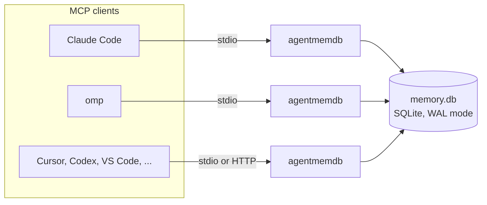
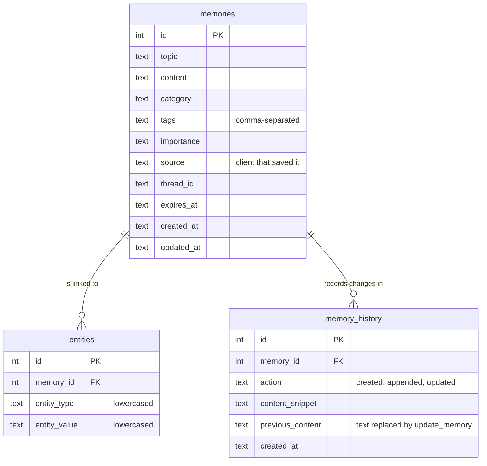

# Architecture

## Overview

Each MCP client normally starts its own agentmemdb process over stdio. The processes hold no state of their own: everything lives in one SQLite file, so a memory saved through one client is visible to every other client immediately. SQLite's WAL mode lets them read and write the file concurrently.

## Package layout

| Module | Responsibility |
|-|-|
| `cli.py` | Command-line entry point: `--transport`, `--port`, `--check`, `--version`. Validates the config before starting. |
| `config.py` | Resolves the database and config paths from environment variables and the config file; compiles auto-tag rules; builds the server instructions. |
| `server.py` | The FastMCP application and its 16 tools. Each tool runs inside a wrapper that turns `ToolError` into `{"error": ...}` and always rolls back and closes its connections. |
| `storage.py` | `Store` (tracked SQLite connections), the schema, and migrations. |
| `search.py` | FTS5 query building, BM25-ranked search with a substring fallback, duplicate detection. |
| `models.py` | Categories, importance levels, input validation, timestamps. |

## Data model

`memories_fts` is an FTS5 external-content index over `topic`, `content` and `tags` with the `porter unicode61` tokenizer (stemming, Unicode-aware). Triggers keep it in sync with `memories`. Deleting a memory removes its entities and history through foreign keys.

## Search

`search_memory` runs these steps and returns the results of the first one that matches:

1. The query as typed, so FTS5 syntax works (`tags:aws`, `datadog OR sentry`, `"exact phrase"`).
2. Every term, each quoted (`"PR" "#3056"`), so punctuation in IDs, hostnames and hyphenated names can't break the query.
3. Any term, which makes plain questions like "why are we moving billing to postgres" work.
4. Substring matching on topic, content and tags, for partial words FTS can't match (`gres` in `postgres`), ranked by how many query words match.

FTS results are ranked by BM25 with column weights topic 10, tags 5, content 1. Expiry and the category and importance filters are applied in SQL before the limit, through an `is_expired()` SQL function. Each result includes a snippet of about 32 tokens instead of the full content; `full_content=true` or `get_memory` returns everything.

## Duplicate detection

`save_memory` warns about likely duplicates before inserting. Candidates are memories with the same topic (case-insensitive), or topics that share at least two significant words covering 60% of the shorter topic. Stop words, words under three characters and numbers of up to four digits (years, small counts) don't count. `find_duplicates` uses the same rule to group similar memories across the whole database.

## Concurrency and reliability

- **WAL mode** lets readers and writers in different processes work at the same time. Writers wait up to 10 seconds for the lock (`busy_timeout`).
- **No leaked locks.** Every tool call opens its own connection, and a wrapper rolls back and closes every connection the call opened, even when it raises. A failed call can't leave the database locked for other agents.
- **Validate before writing.** Inputs (category, importance, expiry, entities) are checked before the first write, so invalid calls change nothing.
- **Private by default.** A database directory that agentmemdb creates gets mode `0700`.

## Schema migrations

The schema version is stored in `PRAGMA user_version`. On the first connection, agentmemdb creates any missing tables, then applies pending migrations inside a single `BEGIN IMMEDIATE` transaction, so concurrent first starts can't both migrate. Migrations are idempotent and one-way.

| Version | Change |
|-|-|
| 1 | Porter stemming in the FTS index (rebuilt), `memory_history.previous_content`, lowercased and deduplicated entities |

## Design choices

- **SQLite and FTS5 instead of embeddings.** No model to download, no API key, no vector store, and results are explainable. Agents phrase their own queries and can retry with different words, which suits keyword search well.
- **A single file.** Easy to back up, inspect with `sqlite3`, or move between machines.
- **Snippets by default.** Search responses stay small, so recall costs few tokens.
- **Client attribution from the MCP handshake.** `source` defaults to the client name the client reports, so attribution works without configuration.
